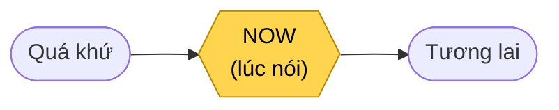
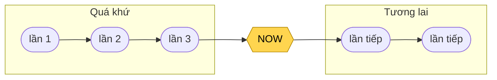
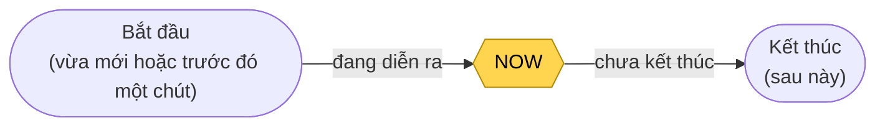
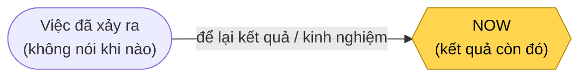
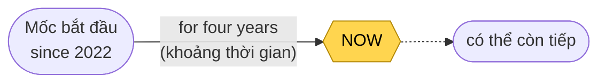
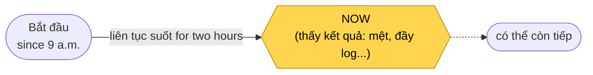
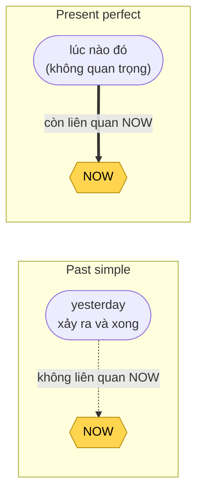
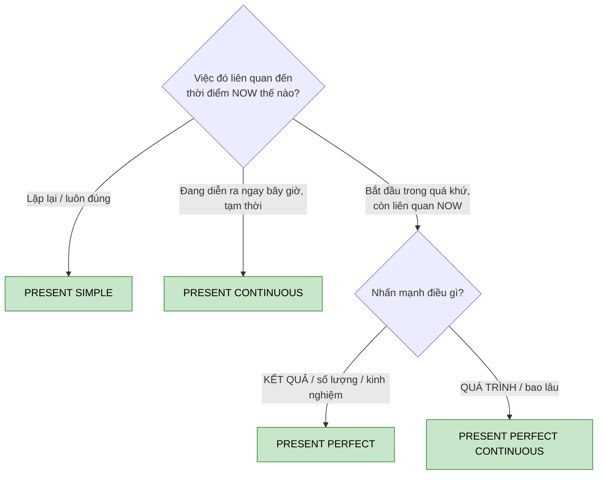

# Bốn thì hiện tại (present tenses) - sơ đồ thời gian và so sánh

Tài liệu tổng quan, đứng trên hai file chi tiết đã có: [hiện tại đơn](03-present-simple.md) và [hiện tại tiếp diễn](05-present-continuous.md). Hai thì còn lại (hoàn thành, hoàn thành tiếp diễn) học đầy đủ ở giai đoạn A2 (tháng 4–8); ở đây chỉ nắm khung, sơ đồ và cách phân biệt.

## Mục tiêu

- Vẽ được sơ đồ thời gian của cả 4 thì và giải thích bằng lời của mình vì sao chọn thì đó.
- Chọn đúng thì trong câu tình huống, đúng ≥ 10/12 bài tập cuối file.
- Nói và viết được 3 câu về công việc của mình cho mỗi thì (12 câu), được sửa lỗi.

## Cách đọc sơ đồ thời gian

Tên "hiện tại" của 4 thì chỉ nghĩa là **thì có liên quan đến thời điểm nói (NOW)**, không có nghĩa là việc luôn xảy ra ngay bây giờ. Mỗi thì trả lời một câu hỏi khác nhau:

| Thì | Câu hỏi nó trả lời | Từ khóa |
|---|---|---|
| Present simple | Việc này **thường xuyên / luôn luôn đúng** không? | always, every day, usually |
| Present continuous | Việc này **đang diễn ra** (tạm thời) không? | now, at the moment, these days |
| Present perfect | Việc này **đã xong và còn liên quan** đến bây giờ không? | already, yet, just, ever, since, for |
| Present perfect continuous | Việc này **đã diễn ra liên tục đến bây giờ** (và có thể còn tiếp)? | for, since, all day, lately |

Quy ước trong các sơ đồ (đọc từ trái sang phải, từ quá khứ đến tương lai):



- Ô vàng **NOW** là lúc bạn nói.
- Mũi tên liền (→) là việc diễn ra hoặc kéo dài tới đó; mũi tên đứt nét (⇢) là phần không chắc hoặc không liên quan.

## 1. Present simple (hiện tại đơn)

### Công thức

```text
(+) I/You/We/They + V           | He/She/It + V-s/es
(-) I/You/We/They + don't + V   | He/She/It + doesn't + V
(?) Do + I/you/we/they + V?     | Does + he/she/it + V?
```

### Sơ đồ thời gian



Việc lặp lại đều đặn ở mọi thời điểm. NOW chỉ là một điểm trên chuỗi đó, không có gì đặc biệt.

### Khi nào dùng

- Thói quen, lịch cố định: *The stand-up starts at 9:30.*
- Sự thật, trạng thái lâu dài: *Our service runs on Kubernetes.*
- Lịch trình, thời gian biểu: *The train leaves at 8:15.*

### Ví dụ có ngữ cảnh

| Ngữ cảnh | Câu |
|---|---|
| Giới thiệu bản thân với đồng nghiệp mới | *I work as a backend developer. I usually start at nine.* |
| Mô tả hệ thống trong cuộc họp | *The API gateway receives every request and routes it to the right service.* |
| Hỏi thói quen | *How often do you deploy to production?* - *We deploy twice a week.* |

## 2. Present continuous (hiện tại tiếp diễn)

### Công thức

```text
(+) S + am/is/are + V-ing
(-) S + am/is/are + not + V-ing
(?) Am/Is/Are + S + V-ing?
```

### Sơ đồ thời gian



Việc đã bắt đầu, chưa kết thúc, và **tạm thời**. NOW nằm **giữa** việc đó.

### Khi nào dùng

- Đang xảy ra ngay lúc nói: *Please wait, I'm checking the logs.*
- Tạm thời, quanh thời điểm này (cả khi lúc nói chưa làm): *I'm working from home this week.*
- Thay đổi, xu hướng đang diễn ra: *Our traffic is growing fast.*
- Kế hoạch đã sắp xếp trong tương lai gần: *We're meeting the client on Friday.*

### Ví dụ có ngữ cảnh

| Ngữ cảnh | Câu |
|---|---|
| Đang họp online, bị hỏi giữa chừng | *Sorry, I'm sharing my screen. Can you see it?* |
| Giải thích vì sao chậm trả lời | *I'm fixing a production bug right now, so I'll reply in an hour.* |
| Nói về giai đoạn tạm thời | *This month we're migrating the database to a new cluster.* |

### Động từ trạng thái (stative verbs)

Các động từ chỉ trạng thái, cảm nhận, sở hữu thường **không** dùng tiếp diễn: *know, understand, like, love, want, need, believe, have (sở hữu), own, belong*.

- *I understand the problem.* (không phải *I am understanding*)
- Nhưng *have* nghĩa "ăn, tổ chức" thì dùng được: *We're having a meeting.*

## 3. Present perfect (hiện tại hoàn thành)

### Công thức

```text
(+) S + have/has + V3 (past participle)
(-) S + have/has + not (haven't/hasn't) + V3
(?) Have/Has + S + V3?
```

V3 của động từ có quy tắc là V-ed (*work → worked*); bất quy tắc phải học thuộc (*go → gone, write → written, see → seen, do → done*).

### Sơ đồ thời gian



Trọng tâm là **kết quả hoặc kinh nghiệm ở hiện tại**, không phải thời điểm cụ thể trong quá khứ.

Với **for/since**, việc bắt đầu trong quá khứ và còn đúng đến bây giờ:



### Khi nào dùng

| Cách dùng | Ví dụ |
|---|---|
| Kết quả hiện tại của việc vừa xong | *I've fixed the bug.* (bây giờ nó chạy được) |
| Kinh nghiệm, không nói khi nào | *Have you ever used Terraform?* |
| Trạng thái kéo dài đến nay (for/since) | *I've worked here for three years.* |
| Tin mới (just, already, yet) | *We've just released version 2.0.* |

**Quy tắc vàng:** nếu câu có thời điểm quá khứ xác định (*yesterday, last week, in 2023, two days ago*) thì dùng **past simple**, không dùng present perfect.

### Ví dụ có ngữ cảnh

| Ngữ cảnh | Câu |
|---|---|
| Báo cáo trong stand-up | *I've finished the code review, but I haven't started the tests yet.* |
| Phỏng vấn xin việc | *I've managed a team of five engineers for two years.* |
| Hỏi kinh nghiệm ứng viên | *Have you ever handled a production outage?* |
| Cập nhật cho khách hàng | *The team has already fixed the issue. You can try again now.* |

## 4. Present perfect continuous (hiện tại hoàn thành tiếp diễn)

### Công thức

```text
(+) S + have/has + been + V-ing
(-) S + have/has + not + been + V-ing
(?) Have/Has + S + been + V-ing?
```

### Sơ đồ thời gian



Trọng tâm là **quá trình kéo dài** đến bây giờ, thường để giải thích một **kết quả nhìn thấy được** (mệt, ướt, đầy log...).

### Khi nào dùng

- Việc đang diễn ra từ quá khứ đến bây giờ, nhấn mạnh thời gian: *I've been debugging this since morning.*
- Việc vừa dừng nhưng còn dấu vết: *You look tired. - Yes, I've been working all night.*
- Hỏi *how long*: *How long have you been learning English?*

### Ví dụ có ngữ cảnh

| Ngữ cảnh | Câu |
|---|---|
| Giải thích vì sao trễ | *Sorry for the delay. I've been waiting for the build to finish.* |
| Nói về quá trình học | *I've been studying English for two weeks.* |
| Nhắc đồng nghiệp | *The server has been running slowly all day. Can you check it?* |

## So sánh nhanh

### Simple hay continuous?

| | Present simple | Present continuous |
|---|---|---|
| Ý | Thói quen, sự thật | Đang diễn ra, tạm thời |
| Ví dụ | *He works at night.* (lịch làm việc của anh ấy) | *He is working tonight.* (đêm nay, khác thường) |
| Ví dụ | *I live in Hanoi.* (lâu dài) | *I'm living in Hanoi for now.* (tạm thời) |

### Perfect hay continuous (hoàn thành hay hoàn thành tiếp diễn)?

| | Present perfect | Present perfect continuous |
|---|---|---|
| Nhấn mạnh | Kết quả, số lượng | Quá trình, thời gian |
| Ví dụ | *I've written three emails.* (đã có 3 email) | *I've been writing emails all morning.* (cả buổi sáng) |
| How many / how long | How **many** emails have you written? | How **long** have you been writing? |

### Present perfect hay past simple?



| Past simple | Present perfect |
|---|---|
| *I deployed the fix yesterday.* | *I've deployed the fix.* (nên bây giờ bạn thử lại được) |
| *She lived in Singapore for two years.* (giờ không ở đó nữa) | *She has lived in Singapore for two years.* (giờ vẫn ở đó) |

### Tóm tắt một ví dụ qua cả 4 thì

Cùng chủ đề *learn English*:

| Thì | Câu | Ý |
|---|---|---|
| Present simple | *I study English every morning.* | thói quen |
| Present continuous | *I'm studying English now.* | đang học lúc này |
| Present perfect | *I've finished Week 1.* | xong rồi, hiện có kết quả |
| Present perfect continuous | *I've been studying for 30 minutes.* | đã học liên tục đến giờ |

## Chọn thì: sơ đồ quyết định



## Dấu hiệu nhận biết

| Thì | Dấu hiệu |
|---|---|
| Present simple | always, usually, often, sometimes, never, every day/week, on Mondays |
| Present continuous | now, right now, at the moment, today, this week, currently |
| Present perfect | just, already, yet, ever, never, so far, recently, since, for |
| Present perfect continuous | for, since, all day, all morning, lately, recently, how long |

## Lỗi thường gặp

| Sai | Đúng | Lý do |
|---|---|---|
| I am knowing the answer. | I know the answer. | động từ trạng thái không dùng tiếp diễn |
| She work here for two years. | She has worked here for two years. | for + khoảng thời gian cần present perfect, và thiếu has |
| I have finished it yesterday. | I finished it yesterday. | có thời điểm quá khứ xác định → past simple |
| He has been to Japan in 2023. | He went to Japan in 2023. | như trên |
| I work here since 2022. | I have worked here since 2022. | since + mốc thời gian cần present perfect |
| I have been work on it. | I have been working on it. | sau been là V-ing |
| Does she works here? | Does she work here? | sau does là nguyên mẫu |
| I have seen him two hours ago. | I saw him two hours ago. | *ago* đi với past simple |
| I have been writing three emails. | I have written three emails. | có số lượng → present perfect |

## Bài tập

Chọn dạng đúng của động từ trong ngoặc.

1. We usually ___ (have) the team meeting on Monday.
2. Please be quiet. I ___ (talk) to a customer.
3. I ___ (work) here since 2022.
4. She ___ (not finish) the report yet.
5. How long ___ you ___ (learn) English?
6. The sun ___ (rise) in the east.
7. Look! The deployment ___ (fail).
8. I ___ (wait) for the build for 20 minutes. It's still running.
9. Chọn: *I have met him yesterday / I met him yesterday.*
10. Chọn: *I have written / I have been writing* five emails today.
11. Chọn: *He is working / He works* from home this week (khác thường).
12. Sửa lỗi: *She is knowing the manager well.*

## Đáp án

1. have
2. am talking
3. have worked
4. hasn't finished
5. have ... been learning
6. rises
7. has failed (kết quả nhìn thấy ngay) - cũng chấp nhận *is failing* nếu đang thấy lỗi lặp lại
8. have been waiting
9. I met him yesterday.
10. I have written
11. He is working
12. She knows the manager well.

## Nguồn

- Tự soạn. Đối chiếu với British Council LearnEnglish - Grammar (Present tenses).
- Gợi ý đọc thêm: *English Grammar in Use* (Raymond Murphy), các bài về present simple/continuous/perfect. TODO: xác minh số đơn vị (unit) cụ thể theo ấn bản đang dùng.
