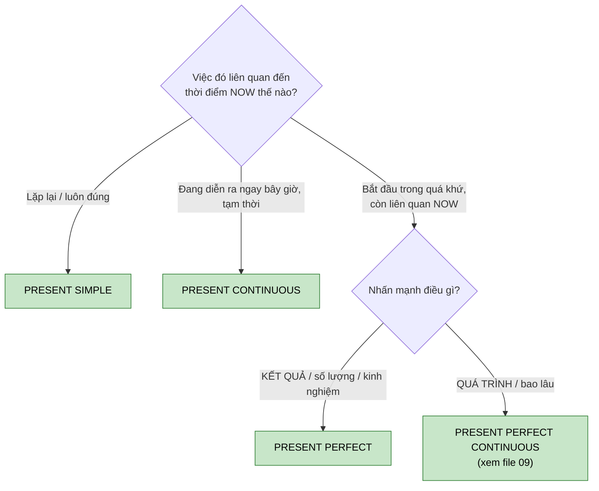

# Các thì thường dùng (common tenses) - hiện tại, quá khứ, tương lai

Tổng quan các thì **dùng hằng ngày** trong nói, viết và công việc, kèm sơ đồ thời gian. Bổ sung cho hai file chi tiết [hiện tại đơn](03-present-simple.md) và [hiện tại tiếp diễn](05-present-continuous.md). Các thì **ít gặp** (chỉ cần nhận ra, và hiện tại hoàn thành tiếp diễn) nằm ở [file 09](09-rare-tenses.md).

## Mục tiêu

- Vẽ được sơ đồ thời gian của 8 thì/cấu trúc ở file này và giải thích bằng lời của mình vì sao chọn thì đó.
- Chọn đúng thì trong câu tình huống, đúng ≥ 14/17 bài tập cuối file.
- Nói và viết được 3 câu về công việc của mình cho mỗi thì (24 câu), được sửa lỗi.

## Bảng 12 thì và mức độ thường gặp

| | Quá khứ (past) | Hiện tại (present) | Tương lai (future) |
|---|---|---|---|
| **Simple** | **S + V2** (rất thường) | **S + V / V-s** (rất thường) | **will + V** (rất thường) |
| **Continuous** | **was/were + V-ing** (thường) | **am/is/are + V-ing** (rất thường) | will be + V-ing (ít gặp) |
| **Perfect** | **had + V3** (khá thường) | **have/has + V3** (rất thường) | will have + V3 (ít gặp) |
| **Perfect continuous** | had been + V-ing (ít gặp) | have/has been + V-ing (vừa phải) | will have been + V-ing (rất ít gặp) |

- **In đậm** là các thì học ở file này; phần còn lại ở [file 09](09-rare-tenses.md).
- *be going to + V* không phải một thì riêng, nhưng rất thường dùng để nói về tương lai nên có mục riêng bên dưới.
- Tên "hiện tại" của các thì present chỉ nghĩa là **có liên quan đến thời điểm nói (NOW)**, không có nghĩa là việc luôn xảy ra ngay bây giờ.

## Cách đọc sơ đồ thời gian

Trục chạy từ quá khứ (trái) sang tương lai (phải); **[ NOW ]** ở giữa là lúc nói.

```text
QUÁ KHỨ                     HIỆN TẠI                    TƯƠNG LAI
◀────────────────────────────[ NOW ]────────────────────────────▶
```

- `●` là một sự việc tại một thời điểm; `├━━━┤` là việc kéo dài, có đầu và cuối.
- Nét liền (`━`) là phần chắc chắn đã xảy ra; nét đứt (`╌`) là phần có thể còn tiếp hoặc chỉ là mối liên hệ; `╌╌▶` nghĩa là việc này xảy ra **trước** một mốc khác (hoặc trước NOW).
- Với thì quá khứ và tương lai, mốc so sánh không phải lúc nào cũng là NOW mà có thể là một **mốc khác** (ví dụ lúc anh ấy đến, hạn chót thứ Sáu).

## Thì hiện tại

### 1. Present simple (hiện tại đơn)

```text
(+) I/You/We/They + V           | He/She/It + V-s/es
(-) I/You/We/They + don't + V   | He/She/It + doesn't + V
(?) Do + I/you/we/they + V?     | Does + he/she/it + V?
```

```text
QUÁ KHỨ                     HIỆN TẠI                    TƯƠNG LAI
     ●         ●         ●                 ●         ●         ●
◀────────────────────────────[ NOW ]────────────────────────────▶
   lần 1     lần 2     lần 3              lần 4     lần 5     lần 6
```

Việc lặp lại đều đặn ở mọi thời điểm; NOW chỉ là một điểm trên chuỗi đó.

- Thói quen, lịch cố định: *The stand-up starts at 9:30.*
- Sự thật, trạng thái lâu dài: *Our service runs on Kubernetes.*
- Lịch trình, thời gian biểu: *The train leaves at 8:15.*

| Ngữ cảnh | Câu |
|---|---|
| Giới thiệu bản thân với đồng nghiệp mới | *I work as a backend developer. I usually start at nine.* |
| Mô tả hệ thống trong cuộc họp | *The API gateway receives every request and routes it to the right service.* |
| Hỏi thói quen | *How often do you deploy to production?* - *We deploy twice a week.* |

### 2. Present continuous (hiện tại tiếp diễn)

```text
(+) S + am/is/are + V-ing
(-) S + am/is/are + not + V-ing
(?) Am/Is/Are + S + V-ing?
```

```text
QUÁ KHỨ                     HIỆN TẠI                    TƯƠNG LAI
                     đang diễn ra (tạm thời)
                    ├━━━━━━━━━━━━━━━━━━━━━━━━━┤
◀────────────────────────────[ NOW ]────────────────────────────▶
                 bắt đầu                   kết thúc
            (vừa mới / trước đó)            (sau này)
```

Việc đã bắt đầu, chưa kết thúc, và **tạm thời**. NOW nằm **giữa** việc đó.

- Đang xảy ra ngay lúc nói: *Please wait, I'm checking the logs.*
- Tạm thời, quanh thời điểm này: *I'm working from home this week.*
- Thay đổi, xu hướng đang diễn ra: *Our traffic is growing fast.*
- Kế hoạch đã sắp xếp trong tương lai gần: *We're meeting the client on Friday.*

| Ngữ cảnh | Câu |
|---|---|
| Đang họp online, bị hỏi giữa chừng | *Sorry, I'm sharing my screen. Can you see it?* |
| Giải thích vì sao chậm trả lời | *I'm fixing a production bug right now, so I'll reply in an hour.* |

**Động từ trạng thái (stative verbs)** thường **không** dùng tiếp diễn: *know, understand, like, love, want, need, believe, have (sở hữu), own, belong*. Nói *I understand the problem* (không phải *I am understanding*). Nhưng *have* nghĩa "ăn, tổ chức" thì dùng được: *We're having a meeting.*

### 3. Present perfect (hiện tại hoàn thành)

```text
(+) S + have/has + V3 (past participle)
(-) S + have/has + not (haven't/hasn't) + V3
(?) Have/Has + S + V3?
```

V3 của động từ có quy tắc là V-ed (*work → worked*); bất quy tắc phải học thuộc (*go → gone, write → written, see → seen, do → done*).

```text
QUÁ KHỨ                     HIỆN TẠI                    TƯƠNG LAI
          ●╌╌╌╌╌╌╌╌╌╌╌╌╌╌╌╌╌╌▶
◀────────────────────────────[ NOW ]────────────────────────────▶
      đã xảy ra             kết quả / kinh nghiệm còn đó
  (không nói khi nào)
```

Trọng tâm là **kết quả hoặc kinh nghiệm ở hiện tại**, không phải thời điểm cụ thể trong quá khứ. Với **for/since**, việc bắt đầu trong quá khứ và còn đúng đến bây giờ:

```text
QUÁ KHỨ                     HIỆN TẠI                    TƯƠNG LAI
              for four years
      ├━━━━━━━━━━━━━━━━━━━━━━━━━━━━━╌╌╌╌╌╌╌╌╌╌▶
◀────────────────────────────[ NOW ]────────────────────────────▶
    since 2022                                 có thể còn tiếp
  (mốc bắt đầu)
```

| Cách dùng | Ví dụ |
|---|---|
| Kết quả hiện tại của việc vừa xong | *I've fixed the bug.* (bây giờ nó chạy được) |
| Kinh nghiệm, không nói khi nào | *Have you ever used Terraform?* |
| Trạng thái kéo dài đến nay (for/since) | *I've worked here for three years.* |
| Tin mới (just, already, yet) | *We've just released version 2.0.* |

**Quy tắc vàng:** nếu câu có thời điểm quá khứ xác định (*yesterday, last week, in 2023, two days ago*) thì dùng **past simple**, không dùng present perfect.

| Ngữ cảnh | Câu |
|---|---|
| Báo cáo trong stand-up | *I've finished the code review, but I haven't started the tests yet.* |
| Phỏng vấn xin việc | *I've managed a team of five engineers for two years.* |
| Cập nhật cho khách hàng | *The team has already fixed the issue. You can try again now.* |

## Thì quá khứ

### 4. Past simple (quá khứ đơn)

```text
(+) S + V2 / V-ed            (-) S + did not (didn't) + V
(?) Did + S + V?             to be: was / were
```

```text
QUÁ KHỨ                     HIỆN TẠI                    TƯƠNG LAI
        ●  yesterday
◀────────────────────────────[ NOW ]────────────────────────────▶
      xảy ra rồi xong, có mốc rõ ràng, không còn liên quan NOW
```

- Việc đã xảy ra và kết thúc ở thời điểm xác định: *We released version 2.0 last Friday.*
- Chuỗi việc kể lại theo thứ tự: *I opened the log, found the error and restarted the service.*
- Dấu hiệu: yesterday, last week, in 2023, two days ago, when + mốc quá khứ.

| Ngữ cảnh | Câu |
|---|---|
| Kể lại sự cố | *The server went down at 3 a.m. and I fixed it in an hour.* |
| Phỏng vấn | *I joined my last company in 2022.* |
| Hỏi lịch sử | *When did you start learning English?* |

### 5. Past continuous (quá khứ tiếp diễn)

```text
(+) S + was/were + V-ing     (-) S + was/were + not + V-ing
(?) Was/Were + S + V-ing?
```

```text
QUÁ KHỨ                     HIỆN TẠI                    TƯƠNG LAI
               ●  server crashed (past simple)
      ├━━━━━━━━━━━━━━━━━━┤  was debugging
◀────────────────────────────[ NOW ]────────────────────────────▶
      đang diễn ra tại một mốc trong quá khứ
```

- Việc đang diễn ra tại một thời điểm trong quá khứ: *At 9 a.m. yesterday I was attending a meeting.*
- Việc đang diễn ra thì bị việc khác **cắt ngang** (việc cắt ngang dùng past simple): *I was debugging when the server crashed.*
- Hai việc diễn ra song song: *She was writing code while he was reviewing it.*

| Ngữ cảnh | Câu |
|---|---|
| Giải thích vì sao không nghe máy | *Sorry, I was talking to a client when you called.* |
| Kể bối cảnh | *It was raining, so we were working from home.* |

### 6. Past perfect (quá khứ hoàn thành)

```text
(+) S + had + V3             (-) S + had not (hadn't) + V3
(?) Had + S + V3?
```

```text
QUÁ KHỨ                     HIỆN TẠI                    TƯƠNG LAI
        ●╌╌╌╌╌╌╌╌╌╌▶●
◀────────────────────────────[ NOW ]────────────────────────────▶
   had finished     left (mốc quá khứ)
```

Là "quá khứ của quá khứ": hai việc cùng ở quá khứ, việc nào xảy ra **trước** thì dùng past perfect, việc sau dùng past simple.

- *When I arrived, the meeting had already started.*
- *He told me he had fixed the bug before the release.*
- Dấu hiệu: already, just, before, by the time, after, when (kèm một việc quá khứ khác).

| Ngữ cảnh | Câu |
|---|---|
| Giải thích kết quả trong quá khứ | *The deployment failed because nobody had updated the config.* |
| Kể trước-sau | *By the time I logged in, the issue had been resolved.* |

## Thì tương lai

Tiếng Anh không có một "thì tương lai" duy nhất. Chọn cách nói theo **thái độ của người nói** với việc đó (quyết định tức thời, dự định, kế hoạch đã xếp, dự đoán).

### 7. Future simple (tương lai đơn): will + V

```text
(+) S + will + V             (-) S + will not (won't) + V
(?) Will + S + V?
```

```text
QUÁ KHỨ                     HIỆN TẠI                    TƯƠNG LAI
                                                 ●  will deploy
◀────────────────────────────[ NOW ]────────────────────────────▶
                          quyết định ngay lúc nói / dự đoán / hứa
```

- Quyết định ngay lúc nói: *The build failed? OK, I'll check it now.*
- Lời hứa, đề nghị: *I'll send you the report this afternoon.*
- Dự đoán dựa trên ý kiến (I think, probably): *I think the client will agree.*

### 8. Be going to + V

```text
(+) S + am/is/are + going to + V
(-) S + am/is/are + not + going to + V
(?) Am/Is/Are + S + going to + V?
```

```text
QUÁ KHỨ                     HIỆN TẠI                    TƯƠNG LAI
                                    ╌╌╌╌╌╌╌╌╌╌╌▶●  going to move
◀────────────────────────────[ NOW ]────────────────────────────▶
                     có dự định / dấu hiệu từ NOW
```

- Dự định đã có từ trước lúc nói: *I'm going to move to a new team next month.*
- Dự đoán dựa vào dấu hiệu nhìn thấy ngay bây giờ: *Look at the error rate. The system is going to crash.*

| will | be going to |
|---|---|
| Quyết định tức thời: *I'll call him.* | Đã quyết định trước: *I'm going to call him after lunch.* |
| Dự đoán theo ý kiến: *I think it will work.* | Dự đoán theo bằng chứng: *It's going to rain.* |

Kế hoạch đã sắp xếp cụ thể (có giờ, có người) có thể dùng present continuous: *We're meeting the client on Friday.*

**Mệnh đề thời gian:** sau *when, after, before, as soon as, until, by the time*, nói về tương lai vẫn dùng **thì hiện tại**, không dùng *will*: *When I arrive, I'll call you.* (không phải *When I will arrive*)

## So sánh nhanh

### Simple hay continuous?

| | Simple | Continuous |
|---|---|---|
| Ý | Thói quen, sự thật | Đang diễn ra, tạm thời |
| Ví dụ | *He works at night.* (lịch làm việc của anh ấy) | *He is working tonight.* (đêm nay, khác thường) |
| Ví dụ | *I live in Hanoi.* (lâu dài) | *I'm living in Hanoi for now.* (tạm thời) |

### Present perfect hay past simple?

| Past simple | Present perfect |
|---|---|
| *I deployed the fix yesterday.* (có mốc, xong, không nối với NOW) | *I've deployed the fix.* (nên bây giờ bạn thử lại được) |
| *She lived in Singapore for two years.* (giờ không ở đó nữa) | *She has lived in Singapore for two years.* (giờ vẫn ở đó) |

### Các cặp dễ nhầm khác

| Cặp | Khác nhau |
|---|---|
| Past simple / past continuous | Past simple: việc xong. Past continuous: việc đang diễn ra tại mốc đó. |
| Past simple / past perfect | Có hai việc quá khứ: việc xảy ra trước → past perfect. |
| will / be going to | will: quyết định tức thời, ý kiến. Be going to: dự định có sẵn, bằng chứng. |

### Chọn thì: sơ đồ quyết định (hiện tại)



## Dấu hiệu nhận biết

| Thì | Dấu hiệu |
|---|---|
| Present simple | always, usually, often, sometimes, never, every day/week, on Mondays |
| Present continuous | now, right now, at the moment, today, this week, currently |
| Present perfect | just, already, yet, ever, never, so far, recently, since, for |
| Past simple | yesterday, last week, in 2023, two days ago |
| Past continuous | at 9 a.m. yesterday, while, when (việc bị cắt ngang) |
| Past perfect | already, before, by the time, after (kèm một việc quá khứ khác) |
| Future simple / be going to | tomorrow, next week, soon, I think, probably / dấu hiệu nhìn thấy |

## Lỗi thường gặp

| Sai | Đúng | Lý do |
|---|---|---|
| I am knowing the answer. | I know the answer. | động từ trạng thái không dùng tiếp diễn |
| Does she works here? | Does she work here? | sau does là nguyên mẫu |
| She work here for two years. | She has worked here for two years. | for + khoảng thời gian cần present perfect, và thiếu has |
| I work here since 2022. | I have worked here since 2022. | since + mốc thời gian cần present perfect |
| I have finished it yesterday. | I finished it yesterday. | có thời điểm quá khứ xác định → past simple |
| He has been to Japan in 2023. | He went to Japan in 2023. | như trên |
| I have seen him two hours ago. | I saw him two hours ago. | *ago* đi với past simple |
| I go to the meeting yesterday. | I went to the meeting yesterday. | mốc quá khứ → past simple |
| Did you went there? | Did you go there? | sau did là nguyên mẫu |
| When I arrived, the meeting already started. | When I arrived, the meeting had already started. | việc xảy ra trước một việc quá khứ khác → past perfect |
| When I will arrive, I will call you. | When I arrive, I'll call you. | mệnh đề thời gian dùng thì hiện tại |
| I will to send it tomorrow. / She will goes. | I will send it tomorrow. / She will go. | sau will là nguyên mẫu, không có *to*, không thêm -s |

## Bài tập

Chọn dạng đúng của động từ trong ngoặc.

1. We usually ___ (have) the team meeting on Monday.
2. Please be quiet. I ___ (talk) to a customer.
3. I ___ (work) here since 2022.
4. She ___ (not finish) the report yet.
5. The sun ___ (rise) in the east.
6. Look! The deployment ___ (fail).
7. I ___ (work) at my previous company in 2023.
8. At 9 a.m. yesterday I ___ (attend) a meeting.
9. When I arrived, the meeting ___ (already, start).
10. I think the client ___ (agree) with our plan.
11. Look at those clouds! It ___ (rain).
12. Chọn: *I have met him yesterday / I met him yesterday.*
13. Chọn: *He is working / He works* from home this week (khác thường).
14. Chọn: *I was having / I had* a shower when the phone rang.
15. Chọn: *I'll / I'm going to* call the client after lunch (đã quyết định từ sáng).
16. Sửa lỗi: *She is knowing the manager well.*
17. Sửa lỗi: *When I will arrive, I will call you.*

## Đáp án

1. have
2. am talking
3. have worked
4. hasn't finished
5. rises
6. has failed (kết quả nhìn thấy ngay) - cũng chấp nhận *is failing* nếu đang thấy lỗi lặp lại
7. worked
8. was attending
9. had already started
10. will agree
11. is going to rain
12. I met him yesterday.
13. He is working
14. I was having (đang tắm thì điện thoại reo)
15. I'm going to (dự định có từ trước)
16. She knows the manager well.
17. When I arrive, I'll call you.

## Nguồn

- Tự soạn. Đối chiếu với British Council LearnEnglish - Grammar (Present tenses, Past tenses, Future forms).
- Gợi ý đọc thêm: *English Grammar in Use* (Raymond Murphy), các bài về present, past và future. TODO: xác minh số đơn vị (unit) cụ thể theo ấn bản đang dùng.
